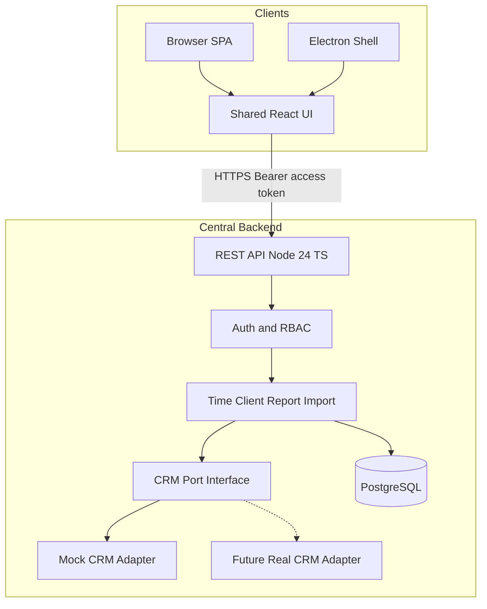
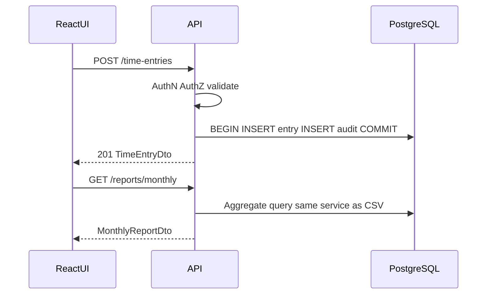
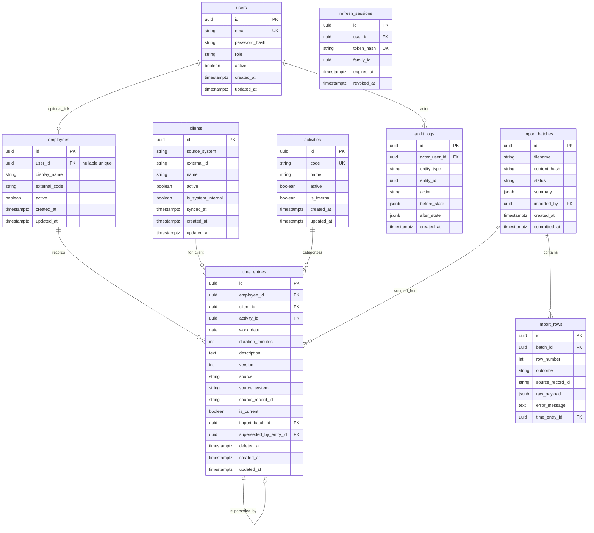

# Accounting Workload & Profitability Management System — Implementation Plan

## Repository status

The workspace [c:\mystuff_c\2026\Automation\Accounting_timer](c:\mystuff_c\2026\Automation\Accounting_timer) is a **greenfield** project (no application code yet). This document is the project copy of the approved implementation plan. Canonical Cursor plan path: `C:\Users\User\.cursor\plans\accounting_workload_plan_337c454b.plan.md`.

**Revision note:** Updated after three Codex reviews. Latest pass resolves T01–T03 (import current-version order, multi-tab refresh, auth transport vs appMode, refresh_sessions model). No architectural rewrite. MVP unchanged.

---

## 1. Business understanding

### Actual business problem

Management cannot reliably answer who spent how much time on which clients and activities, whether that effort is economically justified, and how workloads shift over months — despite reportedly having about two years of time-related records whose structure and quality are unknown.

**Important boundary:** Recorded client-allocated hours measure *allocation to clients/activities*. They do **not** by themselves establish employee productivity, attendance completeness, capacity utilization, or profitability.

### Primary users

- **Accountant (Employee):** record and review own client/activity (and, if confirmed, internal) time
- **Manager:** workload distribution, trends, monthly reports — without simplistic productivity rankings
- **Administrator:** users, roles, activities, imports, system config

### Expected business value

- Visible client effort and capacity imbalances (effort visibility, not productivity scoring)
- Repeatable monthly management reporting with stable semantics
- Earlier identification of potentially unprofitable clients (only after fee/cost rules are agreed — later phase)
- Foundation for CRM-aligned client master data without rewriting the core app

### Two delivery gates (F06)

| Gate | Purpose | Acceptance |
|------|---------|------------|
| **Gate A — Practice prototype** | Solo-developer fictional-data learning/demo system | Mock CRM, time entry, totals, early Electron smoke, synthetic import; documented prototype assumptions |
| **Gate B — Client-specific pilot** | Real or anonymized client data / real infrastructure | Requires discovery: CRM capability, identity source, hosting/network, permissions, retention, operational ownership, sample historical files |

Do **not** treat Gate A success as production readiness or as a pricing basis for Gate B.

### Prototype choices vs client-confirmed requirements

**Architecture choices for the practice prototype (hypothesis, not client-confirmed):**

- Shared React frontend delivered as browser SPA and optional Electron shell
- One centralized Node.js backend; no DB credentials in desktop
- Online-only clients (offline not in scope unless separately confirmed)
- PostgreSQL as system of record
- Mock CRM adapter behind a port interface

**Stated business intents from the brief (still need client validation for a pilot):**

- Time allocation by date / client / activity / duration / optional notes
- Client and employee management (initially fictional)
- Management views: hours by employee, client, activity, month
- Monthly reporting with filters; CSV export at minimum
- Historical import capability (synthetic samples first for Gate A)
- Secure authz appropriate for sensitive commercial/employee data if real data is ever used

### Assumptions (explicitly unverified)

- Solo TypeScript developer builds and maintains Gate A
- Roughly small-firm user scale if a pilot happens — must confirm
- Hungarian locale/date conventions matter for reporting; full legal timekeeping is **out of scope** unless separately commissioned
- Historical files can be mapped after discovery; sufficiency for client-level analysis is **unknown**
- Internal/non-client work may exist; Gate A includes an explicit Internal work client/category so entries are not forced onto real clients (see F08)
- A live start/stop timer is **not** required unless the client later confirms it

### Open questions

Highest impact blockers for Gate B: CRM identity, hosting preference, user count, historical file samples, reporting must-haves, internal-work policy, edit/overlap rules, profitability methodology, employment-law time records. Full list in section 12.

---

## 2. Requirements analysis

### Minimum complete workflow (vertical slice)

Mock CRM clients → select client → record time entry → persist → daily total → monthly aggregate.

This proves auth, client identity, persistence, aggregation rules, and shared UI reuse. Electron packaging is **not** part of the vertical slice itself but follows immediately as an early compatibility smoke (F05).

### Gate A — Practice prototype MVP

- Auth with explicit role matrix (section 4) and tested session lifecycle
- CRUD time entries per matrix; concurrent-edit version check
- Clients: local table with **namespaced** external identity; mock CRM sync
- Support for **internal/non-client work** via a system Internal client (or equivalent) so schema does not force false client attribution
- Activities: admin-managed categories
- Employees: may exist **without** login accounts (historical imports); optional unique user link
- Daily / weekly personal overview
- Management dashboard: hours by employee, client, activity, month — **no** completeness/productivity claims without a validated baseline
- Monthly report + CSV using the reporting contract (section 5 / F03)
- Historical CSV import: preview → validate/map → commit with **record-level** identity (F01/F02); synthetic samples
- Mock CRM adapter implementing the minimal contract (F07)
- Shared web UI + early packaged Electron smoke (not full installer/update infrastructure)
- Transactional audit on first relevant mutations
- Docker Compose for PostgreSQL locally
- Node.js **24 LTS** pinned

### Explicitly out of Gate A MVP

- Real CRM integration
- Actual employee financial data / fees / cost rates
- Full profitability engine
- Official legal working-time compliance
- Offline synchronization
- Full Electron installer, code signing, and auto-update infrastructure
- Microservices, Redis, queues, Kubernetes
- Dashboard “missing allocation” completeness flags (deferred until baseline exists)

### Gate B — Client pilot prerequisites (before real data)

- Answered P0 discovery (section 12), including **privacy and confidentiality**
- **Hard rule:** no real employee or client personal/commercial data may enter any environment until access control, protection (encryption/TLS), retention, backup ownership, and applicable contractual/DPA requirements have been addressed in writing; Gate A remains fictional/synthetic only
- Security validation for real data (access, retention, backup ownership, offboarding)
- CRM feasibility write-up (sync-in only unless more is proven)
- Confirmed report definitions, identity source, internal-work policy, edit rules

### Later product phases (after Gate B / written rules)

- Effective-dated fees and cost rates; **illustrative contribution** only (labeled estimate, not statutory P&L)
- Excel export; period comparison
- Real CRM adapter replacing mock
- Electron distribution/signing if desktop is mandatory
- Attendance/leave workstream as a **separate** compliance project if required

### Requires explicit client confirmation (not treated as facts)

- Browser vs desktop vs both for go-live
- Hosting: cloud vs on-prem; who operates backups/TLS/offboarding
- CRM product and integration model
- Historical file format and samples
- Overlap/duplicate rules; who may edit past entries / month lock
- Whether internal work is in scope and how it is classified
- Profitability costing methodology
- Whether employment attendance tracking is required
- Data retention and GDPR expectations
- Hungarian language UI for production
- Whether a live timer is required (duration entry is the prototype default)

---

## 3. Architecture

### Stack recommendation

- Frontend: React + TypeScript + Vite + Tailwind — **one** UI codebase for browser and Electron
- Desktop: Electron shell only (contextIsolation, sandbox, no nodeIntegration)
- API: Node.js **24 LTS** + TypeScript REST — prefer Fastify for schema validation; Express acceptable
- DB: PostgreSQL + Drizzle ORM + SQL migrations
- Auth: short-lived access JWT + rotating refresh token (strategy in section 4)
- Local infra: Docker Compose for Postgres only
- Monorepo: pnpm workspaces; lockfile committed; engines field pins Node 24
- Package manager: pnpm with lockfile; dependency majors chosen for Node 24 compatibility at scaffold time

Avoid for Gate A: microservices, message queues, GraphQL, Redis, Kubernetes, premature shared packages, generic integration frameworks.

### Lean monorepo structure

```text
apps/
  web/          # Vite React SPA (only UI)
  desktop/      # Electron main + preload; loads web build
  api/          # Node TS REST + CRM mock + import + reports
packages/
  shared-types/ # DTOs, role enums, report filter types only
database/
  migrations/
```

Defer packages/business-rules and packages/crm-integration. Keep CRM port and mock inside apps/api (`apps/api/src/crm/`).

### High-level architecture



### Component responsibilities

- apps/web: UI and apiClient only; no Node/Electron APIs
- apps/desktop: window lifecycle, secure preload, runtime config injection; no business logic, no DB
- apps/api: auth, validation, authorization, aggregations, import, CRM sync, transactional audit
- packages/shared-types: shared contracts only
- PostgreSQL: system of record

### Time-entry data flow



### CRM adapter contract (F07) — minimal, not a framework

**Port methods (client-read only for Gate A):**

- `listClients({ cursor?, pageSize }): Promise<CrmPage<CrmClient>>`
- Typed failures: `CrmAuthError`, `CrmNetworkError`, `CrmInvalidResponseError`, `CrmRateLimitError`

**CrmClient normalized fields:**

- `sourceSystem` (e.g. `mock`, later `vendorname`)
- `externalId` (stable ID **within** that source)
- `displayName`
- `active` (boolean as reported by source for that page)
- `updatedAt` (if available)

**Application storage:**

- Unique on `(source_system, external_id)` — **not** a bare global `external_id`
- **CRM-owned fields** on sync: name, active flag from CRM, synced_at
- **App-owned fields** (never overwritten by sync): local notes, reporting tags added in-app, soft local preferences
- Incomplete sync or partial-page failure: **do not** infer deletion/deactivation of clients missing from an incomplete run
- Deactivation only when source explicitly reports inactive **or** a completed full-sync policy is later agreed (Gate B decision)
- Retries: bounded exponential backoff; sync run status recorded; no unbounded loops

Mock adapter simulates pagination, auth failure, network errors, invalid payloads, and stable IDs.

### CRM capability distinctions (unchanged)

- Sync in (Gate A mock; Gate B if feasible)
- Write-back / embed / native extension — separate unknown capabilities; estimate separately; out of Gate A

### Dev vs production

- Dev / Gate A: Docker Postgres, mock CRM, same-origin web via Vite/API proxy, Electron via constrained custom protocol loading packaged UI, fictional seed
- Gate B / prod (TBD): approved host, real CRM after feasibility **and privacy prerequisites**, HTTPS same-origin (or documented same-site) web+API, Electron only if confirmed — support ownership must be named before quoting delivery

---

## 4. Web and desktop strategy

### Shared React frontend

Single Vite app (`apps/web`). Electron loads **the same production build**. One UI — no second interface. Platform detection behind a thin `platform` module. All HTTP via one `apiClient`.

### Gate A browser deployment topology (R02) — selected

**Same-origin frontend + API via reverse proxy (solo-friendly):**

- Browser talks only to one origin (e.g. `http://localhost:5173` in dev, `https://app.example` in prod).
- Dev: Vite `server.proxy` forwards `/api` → API process.
- Prod-shaped Gate A: static web and `/api` behind one reverse proxy (nginx/Caddy) so cookies are first-party same-origin.
- Do **not** rely on cross-site credentialed cookies between unrelated frontend and API hosts for Gate A.

### Runtime configuration

Single configuration interface:

- `apiBaseUrl` — web uses same-origin relative `/api/v1`; Electron uses absolute API URL from runtime config
- `appMode`: `web` | `desktop` — **transport/config hint only** (which platform adapters to load). Never treated as proof of client identity and never bypasses authn/authz/CSRF/refresh validation (T03)
- Optional `environment` label

**Electron:** main-process reads config file or env; injects into renderer via preload. Early smoke must prove this path. Never solve connectivity by disabling `webSecurity` or allowing arbitrary origins.

### Electron loading strategy (R03) — selected for early smoke

**Constrained custom application protocol** (preferred over `file://`):

- Register a privileged scheme (e.g. `app://`) that serves only the Vite `dist` tree; path traversal outside dist denied
- Load UI with that protocol in the **packaged** production build (verify packaged artifact, not only `electron .` dev)
- React Router: **HashRouter** on desktop; BrowserRouter on web — shared route table, router factory
- `webSecurity: true` always; never disable it to fix CORS
- **Required CSP** on desktop UI responses (default-src/script-src/style-src/connect-src/img-src/font-src locked down; `connect-src` allowlist = configured API origin only)
- `contextIsolation: true`; `nodeIntegration: false`; sandbox enabled where supported
- Navigation: deny in-app navigation away from `app://`; `window.open` / new windows denied except allowlisted; external links only via allowlisted `shell.openExternal`
- Permission handler deny-by-default; IPC sender validation on every preload channel
- **CORS:** API allowlist includes the desktop app origin (`app://…`) **and** the web origin; no wildcard `*` with credentials
- **Electron session auth:** access JWT in renderer memory (Bearer); refresh token in `safeStorage` via preload; API calls use absolute `apiBaseUrl` from runtime config
- Early smoke download test: save a **simple fixture file** (not monthly CSV) via blob or narrow preload save dialog

**Full NSIS/MSI installer, code signing, and auto-update remain out of Gate A.**

### What Electron adds

Native window and optional later Windows installers. Not offline DB; not local business rules.

### Platform-specific code

`apps/desktop/main`, `preload.ts`, and `apps/web/src/platform/*` only.

### Authentication and session strategy (R02 / F04 / T02 / T03)

**Shared:** Access token = JWT, ~15 minutes, `Authorization: Bearer` from React memory. Password hashing Argon2id. Login throttling per-IP and per-account. RBAC only on API. Refresh tokens never appear in URLs or logs (redact if accidentally logged).

**Refresh transport is explicit — not inferred from `appMode` (T03):**

| Transport | How presented | Used by |
|-----------|---------------|---------|
| **Cookie** | httpOnly `RefreshToken` cookie only | Browser (same-origin) |
| **Body** | JSON `{ "refreshToken": "..." }` only | Electron |

- Server selects handler from **which credential is actually present**, not from `appMode`.
- Request with **both** cookie and body refresh token → **400** reject as ambiguous.
- Request with neither → **401**.
- `appMode` must not skip Origin/CSRF checks, authn, authz, or refresh-session validation.

**Browser (same-origin proxy, cookie transport):**

1. Login `POST /api/v1/auth/login` → access token in JSON; sets refresh cookie `RefreshToken` httpOnly, `Secure` (prod), `SameSite=Lax`, `Path=/api/v1/auth`. No refresh token in response body for browser.
2. Refresh `POST /api/v1/auth/refresh` with credentials (cookie only); rotating refresh; reuse of rotated token → revoke rotation family / force re-login.
3. Cookie endpoints (`/auth/refresh`, `/auth/logout`) require same-origin `Origin`/`Referer` check. Business APIs require Bearer access token.
4. Access ~15m; refresh ~7d; logout revokes server session and clears cookie.
5. **Disabled user:** every authenticated API request checks `users.active`; if false → **401** immediately; revoke refresh sessions.

**Multi-tab refresh (T02) — Gate A choice:**

- Prefer **BroadcastChannel** (fallback `localStorage` event) so tabs elect a single refresher: one tab refreshes; others await and adopt the new access token from the coordinator message.
- In-tab single-flight still applies.
- Documented prototype limitation if BroadcastChannel unavailable: treat as **best-effort**; server refresh-reuse detection remains the safety net. Do **not** silently revoke an entire legitimate multi-tab session on a benign race without this coordination — only revoke the rotation **family** on proven refresh-token **reuse** after rotation (theft/race abuse signal).

**Electron (body transport):**

1. Login returns access token **and** refresh token in JSON (no reliance on cookies).
2. Refresh via JSON body `refreshToken` only; store via `safeStorage` preload.
3. Logout/disable: server revocation + client clear.

RBAC enforced only on API. Frontend may hide controls but never authorizes.

### Server-side refresh-session model (minimal)

Table `refresh_sessions` (solo-friendly; no Redis):

- `id` (uuid PK)
- `user_id` (FK → users)
- `token_hash` (unique; store hash only, never plaintext)
- `family_id` (uuid; rotation family)
- `expires_at`
- `revoked_at` (nullable)
- `created_at`, `replaced_by_session_id` (nullable)

Login creates a session row. Refresh: validate hash + not revoked + not expired + user active → revoke old row → insert new row same `family_id` → issue new token. Reuse of an already-rotated token → revoke all sessions in that `family_id`. Logout sets `revoked_at`.

### Operation-by-role permissions matrix (F04)

| Operation | Employee | Manager | Admin |
|-----------|----------|---------|-------|
| Create own time entry | Yes | Yes | Yes |
| Edit/delete own time entry | Yes (unless month locked — client rule later) | Yes | Yes |
| View own entries / daily / weekly | Yes | Yes | Yes |
| View others’ entries | No | Yes | Yes |
| Edit/delete others’ entries | No | Yes | Yes |
| View management aggregates / monthly report | No | Yes | Yes |
| Export CSV | No | Yes | Yes |
| Run historical import | No | No | Yes |
| View import batches / row outcomes | No | No | Yes |
| View audit history | No | No | Yes |
| CRM sync trigger | No | No | Yes |
| Manage users / roles / deactivate | No | No | Yes |
| Manage activities / employees master data | No | No | Yes |
| Manage clients locally (non-CRM fields) | No | No | Yes |

Prototype default; Gate B may adjust after confirmation. Implement and test this matrix on every relevant endpoint before expanding UI.

### Secure API communication

HTTPS in production; CORS allowlist = web origin + Electron `app://` origin only; `webSecurity` never disabled; no secrets in installer or React bundle.

### Dual-platform limitations

Two distribution channels if desktop is required; auth storage differs by platform behind one adapter; no offline without redesign; Windows code signing needed for serious distribution (Gate B+).

### If offline becomes mandatory

Separate scope: local persistence, sync queue, conflicts, deletion propagation — not foreshadowed in Gate A beyond avoiding renderer DB access.

### Electron security baseline (Gate A required)

- Custom `app://` protocol serving dist only; `webSecurity: true`
- Required CSP; `contextIsolation: true`; `nodeIntegration: false`; sandbox where supported
- Minimal preload allowlist; validate IPC sender
- Navigation / `window.open` restrictions; permission handler deny-by-default
- `shell.openExternal` allowlist only; no remote module
- Packaged-build verification required for smoke acceptance

---

## 5. Database design

### Core entities



### Constraints and indexes (F09)

- `duration_minutes > 0` and `<= 24*60` (prototype cap; client may revise)
- `employees.user_id` **nullable**; `UNIQUE` where not null (historical employees need no login)
- `clients` UNIQUE `(source_system, external_id)`
- System Internal client: `is_system_internal = true` (seeded); time entries may reference it for non-client work
- FK RESTRICT (or equivalent) on delete of employees/clients/activities that still have time_entries — deactivate instead of hard delete
- Soft-delete time entries via `deleted_at`; master data uses `active` flags
- `time_entries.version` integer; **PATCH and DELETE** both require expected version (`If-Match` or body) — stale → **409 Conflict** (R06)
- Indexes: `(employee_id, work_date)`, `(client_id, work_date)`, `(work_date)`, `(activity_id, work_date)`, partial unique on **current** import identity (below)
- `time_entries.is_current` boolean; at most one current row per source identity
- `created_at` / `updated_at` on mutable entities; `audit_logs.created_at` required
- Mutation + audit insert in the **same DB transaction**
- Inactive users: revoke refresh sessions **and** reject on every subsequent API request when `active = false`

### Historical import identity (R01 / T01)

**Batch level:** store `content_hash` as an advisory duplicate-file warning (same bytes → warn/block re-upload of identical file).

**Record level (authoritative):**

1. Prefer `source_system + source_record_id` when the file/export provides a stable ID.
2. If no stable ID: compute a **documented candidate key** for review — candidates are **not** silently skipped; Admin reviews “possible duplicate” outcomes.
3. **Partial unique index (current only):** `UNIQUE (source_system, source_record_id) WHERE source_record_id IS NOT NULL AND deleted_at IS NULL AND is_current = true`. Historical superseded rows keep `is_current = false` and the same `source_record_id` for audit; they are outside the unique index.
4. **Correction transaction order (T01) — single DB transaction:**
   1. `SELECT … FOR UPDATE` lock and validate the existing **current** record (expected id/version; `is_current = true`).
   2. Mark that record **non-current** (`is_current = false`).
   3. Insert the replacement row with `is_current = true`.
   4. Link previous → replacement (`superseded_by_entry_id` on the prior row).
   5. Write the audit record(s).
   6. `COMMIT` atomically.
   Concurrent corrections: row lock + partial unique prevent two current rows; loser gets conflict / rollback.
5. **Unchanged reimport:** payload equals current version → outcome `unchanged` (**no-op**).
6. **Manual-edit conflict:** current row manually edited after import → `needs_review`; never silent overwrite.
7. Legitimate identical-looking rows without IDs may both be accepted after review.

### Import workflow (R04 / F02)

```text
upload → validate → map columns → freeze mapping + reviewed row decisions →
preview snapshot (counts, totals, outcomes, expected target versions) →
Admin confirm with preview_id → revalidate → atomic commit
```

**Frozen preview:** `preview_id` stores immutable mapping, approved per-row decisions, and expected current entry id/version for each correction target. Commit must reference that `preview_id`.

**Commit policy: atomic batch commit** for all rows still classified `accepted` after revalidation — all succeed with batch `committed`, or transaction rolls back and batch stays `failed`/`preview` with zero new writes.

**Stale preview:** at commit, re-check record identities and versions. If any target changed since preview (manual edit, other import, delete) → reject commit with conflict details; require **new preview/re-review**. Never silently overwrite a newer manual correction.

**Idempotent repeated commit:** if batch already `committed`, repeat `POST .../commit` returns the existing committed result (no second apply).

Interrupted commit: rollback; safe retry only via re-preview if state drifted, or idempotent return if already committed.

Retain: raw row payload (bounded Gate A retention), per-row outcomes, provenance, importer, timestamps.

Validate: encoding, dates, durations, size/row caps; formula-safe CSV export when monthly CSV exists.

### Monthly reporting contract (F03)

- **Business date:** `work_date` (date). If deriving from timestamps, convert with **Europe/Budapest** then take the calendar date.
- **Month filter:** inclusive start `YYYY-MM-01`, exclusive end next month `YYYY-(MM+1)-01`.
- **Aggregation:** sum integer `duration_minutes`; convert to hours only for display (`minutes / 60`) with display rounding that does **not** feed back into stored totals. CSV exports minutes and optionally decimal hours derived the same way as the UI helper.
- **Inclusion:** open/historical management reports aggregate only `is_current = true AND deleted_at IS NULL` (excludes superseded versions so totals are not double-counted). Superseded rows remain stored for audit/history inspection; they are not deleted by correction.
- **Inactive employees/clients/activities:** still appear on historical reports for periods where entries exist (preserve references; show current display name with inactive marker — historical name snapshot deferred unless client requires it).
- **Corrections:** open reports always reflect **current corrected history** (post-supersede). Finalized/immutable period snapshots are **out of Gate A** unless the client later requires month lock + snapshot.
- **Screen/CSV parity:** one report query/service function; CSV is a serializer over the same DTO/aggregates and filters.

### Client-related vs internal work (F08)

- Gate A seeds an Internal work client (`is_system_internal`) and optionally an Internal activity.
- Dashboard must **not** claim “incomplete allocations” or employee productivity.
- Optional later “day total exceeds N minutes” threshold warning is a **threshold alert only**, not completeness, and is deferred until the client defines expected hours / leave / schedules.
- Do not describe allocated client hours as productivity.

### Phase 2 tables (design now, migrate later)

`monthly_fees`; `cost_rates` with effective dates; optional `direct_costs`. Contribution calc must not treat missing rates as zero silently.

---

## 6. API design

Base path `/api/v1`. JSON. Bearer access token on protected routes.

### MVP endpoints

- Auth: `POST /auth/login`, `/auth/logout`, `/auth/refresh`; `GET /auth/me`
- Time entries: `GET/POST /time-entries`; `GET/PATCH/DELETE /time-entries/:id` (version required on **PATCH and DELETE**; stale → 409)
- Clients: `GET /clients`, `GET /clients/:id`
- Employees: `GET /employees`; Admin `POST/PATCH`
- Activities: `GET /activities`; Admin `POST/PATCH`
- Reports: `GET /reports/summary`, `/reports/monthly`, `/reports/monthly.csv` (same filters/semantics)
- Dashboard: `GET /dashboard/overview` (aggregates only; no completeness claims)
- Imports: `POST /imports/time-entries` (upload); `POST /imports/:id/preview` (freezes decisions → `preview_id`); `POST /imports/:id/commit` body `{ preview_id }` (revalidates; idempotent if already committed); `GET /imports`, `/imports/:id` (row outcomes)
- CRM: `POST /crm/sync/clients`; `GET /crm/sync/status`
- Admin users: `GET/POST/PATCH /users`

### Future endpoints

Fees, cost rates, contribution reports, attendance/leave, Excel export, CRM write-back, webhooks.

Controllers stay thin; authorization and domain logic in services; paginate list endpoints; bound export sizes.

---

## 7. User interfaces

- **Login:** email/password; throttling errors surfaced safely
- **Time entry:** date, client (including Internal), activity, duration, note; save; edit own recent with version conflict handling
- **Daily/weekly overview:** list, totals, navigate
- **Management dashboard:** filters; aggregates by employee/client/activity/month; **no** productivity rankings; **no** unverified completeness flags
- **Monthly report:** month picker, filters, table, CSV download (parity with on-screen totals)
- **Client overview:** active/inactive, recent hours, link to filtered report
- **Administration:** users/roles, activities, CRM sync, import preview/commit, import/audit summaries

Plan i18n keys from day one with `hu` as eventual production target (Gate A may use English strings behind keys).

---

## 8. Testing strategy (risk-ordered)

1. **Reporting contract:** month boundaries (Budapest), deleted/superseded exclusion, inactive identities, integer-minute sums; **screen DTO vs CSV** identical on same fixture (Phase 3+)
2. **Import identity (T01 / R01) — Postgres integration:** corrected import succeeds under lock-then-mark-non-current-then-insert order; unchanged reimport no-op; historical totals not double-counted; concurrent corrections cannot create two `is_current` rows; manual-edit → needs_review
3. **Import commit (R04):** frozen preview; stale preview rejected; repeated commit idempotent; atomic rollback; no silent overwrite of newer manual correction
4. **Authorization matrix:** every relevant endpoint per role
5. **Session lifecycle (R02 / T02 / T03):** same-origin cookie refresh vs body refresh; reject dual-transport; multi-tab BroadcastChannel coordination; refresh-reuse revokes family only; disabled user rejected on next API call; refresh tokens absent from URLs/logs
6. **Concurrent edits (R06):** PATCH and DELETE stale version → 409
7. **Transactional audit:** mutation without audit cannot commit
8. **CRM contract:** pagination; incomplete sync; typed errors; namespaced IDs
9. **DB integration:** constraints, nullable employee user_id, RESTRICT deletes
10. **Web E2E:** vertical slice behind Vite/API proxy
11. **Electron packaged smoke (Phase 2):** login, hash routing, assets, runtime API config, create entry, **fixture file download** (not monthly CSV), CSP/`webSecurity`/protocol assertions on **packaged** build
12. **Monthly CSV download (Phase 3):** real export parity + formula-cell escaping
13. **Build hygiene:** no secrets in artifacts; engines Node 24

No large testing platform required — real Postgres, one API suite, few E2E checks.

---

## 9. Phased implementation plan (reordered)

### Phase 0 — Prototype assumptions and scaffold (Gate A entry)

- **Objective:** Document Gate A assumptions; scaffold monorepo; Postgres up; pin Node 24
- **Tasks:** Document permissions matrix, reporting contract, import identity (current-version unique), same-origin proxy auth, `app://` Electron choice; inspect historical samples **if available** (non-blocking for Gate A); pnpm workspace; Vite `/api` proxy; Compose Postgres; engines/lockfile Node 24
- **Deliverable:** Runnable empty shells + assumptions doc referencing this plan
- **Accept:** DB up; health via proxied `/api`; Node 24 enforced
- **Risks:** Skipping assumptions reintroduces F01–F04 drift
- **Tests:** CI runs on Node 24

### Phase 1 — Vertical slice (authz + audit included)

- **Objective:** Mock CRM → select client → time entry → persist → daily/monthly totals
- **Modules:** schema (namespaced clients, version, audit, Internal client); same-origin proxy auth+matrix; mock CRM; time entry UI; shared report aggregation service (JSON totals; CSV serializer later)
- **Accept:** End-to-end fictional path behind proxy; Employee cannot read others’ entries; audit row with insert; disabled user rejected on next API call
- **Tests:** duration; authz create/list; refresh under same-origin; report month boundary unit; one web E2E
- **Dependencies:** Phase 0
- **Independently implementable:** yes — does not require Electron, import pipeline, or monthly CSV file export

### Phase 2 — Early packaged Electron compatibility smoke (independent milestone)

- **Objective:** Prove same UI build works in a **packaged** Electron app without a second frontend
- **Tasks:** custom `app://` protocol; HashRouter factory; runtime apiBaseUrl; safeStorage refresh; **simple fixture file download**; required CSP; navigation/permission/IPC; `webSecurity` on
- **Accept:** Packaged app login, navigate, create entry against same API, fixture download works; no monthly CSV dependency
- **Out of scope:** signed installer, auto-update, IT distribution, monthly CSV
- **Dependencies:** Phase 1 vertical slice only
- **Tests:** Electron packaged smoke checklist (section 8 item 11)

### Phase 3 — Employee correction workflows + management CSV

- **Objective:** Usable weekly employee UX; manager monthly report/CSV with contract parity
- **Tasks:** edit/delete with **version on PATCH and DELETE**; weekly view; dashboard aggregates; CSV serializer; inactive identity display
- **Accept:** Manager monthly CSV matches on-screen totals for same filters; stale DELETE → 409
- **Explicitly skip:** completeness/missing-allocation flags
- **Dependencies:** Phase 1 (Phase 2 remains an independent early milestone; may run before or overlapping Phase 3)
- **Tests:** screen/CSV parity; PATCH/DELETE 409; authz on reports/export; Electron optional re-check of monthly CSV download after this phase

### Phase 4 — Import preview / commit / recovery

- **Objective:** Synthetic historical import with current-version identity and frozen preview commit
- **Tasks:** upload→map→frozen preview→revalidate→atomic commit; supersede; unchanged no-op; manual-edit review; idempotent recommit; synthetic samples
- **Accept:** Correction uses T01 lock→non-current→insert→link→audit order without unique failure; unchanged reimport no-op; stale preview rejected; failed commit leaves zero new entries; no silent overwrite of newer manual correction; concurrent corrections cannot yield two current rows
- **Dependencies:** Phase 3 (reports exist to reconcile)
- **Tests:** T01/R01/R04 Postgres cases in section 8

### Phase 5 — Gate B discovery and feasibility (client pilot gate)

- **Objective:** Validate CRM/identity/hosting/**privacy** before any real data
- **Tasks:** P0 questions (incl. DPA/access/retention); CRM spike (can start whenever access exists; must complete before pilot); threat review; written privacy prerequisites
- **Accept:** Written go/no-go; **zero real employee/client data loaded** until privacy prerequisites met; no production quote without this
- **Dependencies:** Gate A demo optional but helpful
- **Risks:** Unknown CRM and privacy/contractual readiness dominate schedule

### Phase 6 — Production deploy / full desktop distribution (only if required)

- **Objective:** Approved hosting, backups, restore drill, optional signed Electron
- **Accept:** Named operators; restore tested; rollback procedure documented (restore discards post-backup writes — controlled recovery)
- **Dependencies:** Gate B go

### Phase 7 — Illustrative contribution reporting (only after written fee/cost rules)

- Fees, rates, labeled estimate; missing rates do not become zero silently
- **Dependencies:** Client methodology + Gate B data rules

Do not start legal working-time modules without a separate compliance workstream and professional validation.

---

## 10. Deployment and handover

- **Local:** Node **24 LTS**, pnpm, Docker Desktop; Compose for Postgres; `.env.example` only; lockfile committed
- **Web:** static build behind TLS reverse proxy; Node 24 API via systemd or Docker on approved host
- **Electron:** Gate A smoke via packaged load path; full electron-builder installers/signing only after desktop necessity confirmed
- **Migrations:** Drizzle on release; backup before migrate
- **Credentials:** host env/secret store; never in Electron or React bundle
- **Backups / recovery:** nightly dump; periodic restore test; document that DB-restore rollback drops post-backup writes; name who operates backups before Gate B quote
- **Updates:** web/API pipeline; desktop versioned artifacts if distributed
- **Logging:** structured API logs; DB audit for sensitive mutations
- **Acceptance:**
  - Gate A: fictional UAT checklist only
  - Gate B: anonymized/real data **only after** privacy/DPA/access/retention prerequisites and discovery; written exclusions — not employment-law timekeeping; not full accounting P&L; contribution estimates are illustrative only

---

## 11. Estimation and risks

### Relative effort (solo, indicative — not a delivery commitment)

- Phase 0 assumptions/scaffold: S
- Phase 1 vertical slice: M
- Phase 2 Electron smoke: S–M
- Phase 3 employee + management CSV: M
- Phase 4 import pipeline: M–L (file messiness)
- Phase 5 Gate B discovery/CRM: **unknown / L+**
- Phase 6 production/desktop distribution: M–L if required
- Phase 7 contribution: M after rules exist

### Major schedule drivers

Historical data quality; real CRM feasibility; desktop signing/IT policy; hosting/ops ownership; edit-lock and overlap rules; bilingual polish.

### Known vs unknown work

- **Known (Gate A):** time entry, RBAC matrix, report contract, CSV, mock CRM, Electron smoke, Postgres, import identity/workflow on synthetic data
- **Unknown (Gate B+):** real CRM API, historical mapping success, profitability rules, legal timekeeping, production hosting constraints, support ownership

Do not invent fixed calendar deadlines or project prices from this plan alone. Define production support ownership before quoting delivery.

---

## 12. Client discovery questions (prioritized)

### P0 — before Gate B / any real data / pricing lock

1. Exact CRM name, version, hosting, API/SDK availability and licensing?
2. Integration expectation: sync clients only, write-back, embed, or plugin?
3. Must go-live be browser, desktop, or both? Why desktop?
4. User count and concurrent use?
5. Sanitized samples of the ~2 years of time records? (Gate A may use fully fictional samples)
6. Preferred hosting and **who** administers backups, TLS, offboarding, security updates?
7. Identity source: CRM users, app-local users, or SSO?
8. Is internal/non-client work in scope? How should it be classified?
9. **Privacy/confidentiality (blocking for real data):** DPA/contractual basis, access who/why, encryption/TLS, retention for records/raw imports/audit, employee access-to-own-data, test-vs-prod separation
10. Retention, raw-import storage, and audit retention details (complements #9)?

### P1 — before finishing Gate A polish / before pilot build

11. Monthly report: exact columns and audience?
12. May employees edit past entries? Month lock / finalized periods?
13. Overlapping entries or long days: allow, warn, or block?
14. Who owns the activity category list?
15. UI language: Hungarian only or bilingual?
16. Is a live start/stop timer required, or is duration entry enough?
17. Existing standards from Emoke's software engineer (VPN, AD, device management)?

### P2 — before profitability or HR/attendance scope

18. Client fee structures?
19. Internal cost rates per employee or grade? History available?
20. Is "profitability" contribution margin, full absorption, or advisory only?
21. Are official working-time/attendance records required? Which advisor validates Hungarian rules?
22. Is Excel mandatory for pilot or is CSV enough?

---

## Critical self-review (including Codex revisions)

- Overengineering packages: only shared-types; CRM stays in API
- Unnecessary Redis/microservices/K8s: excluded
- Profitability / real CRM / legal time / offline / full Electron distribution: deferred
- Dual delivery labeled as **prototype hypothesis**, not confirmed client fact
- Gate A vs Gate B separated
- File-hash-only dedupe replaced with record-level identity + correction policy
- Import preview/commit/recovery specified (atomic commit)
- Reporting contract and CSV parity specified
- Role matrix + same-origin proxy browser auth + Electron safeStorage refresh
- Early Electron smoke uses fixture download; monthly CSV tested in Phase 3
- Custom `app://` protocol, required CSP, webSecurity always on
- Import uniqueness = current non-superseded only; frozen preview commit; DELETE versioned
- Real-data privacy prerequisites explicit Gate B blockers (not deferred to P2-only)
- CRM namespaced IDs, field ownership, incomplete-sync safety specified
- Internal work represented; completeness/productivity claims removed
- Node **24 LTS** pinned
- Hidden maintenance: signing, backups, two clients, CRM ownership, restore caveats called out

---

## Final recommendations

### A. Recommended MVP scope (Gate A practice prototype)

Auth + role matrix; namespaced clients + mock CRM sync; Internal work client; activities; versioned time entry CRUD; daily/weekly views; management aggregates; monthly report + CSV with shared semantics; CSV import with preview/atomic commit/record-level identity; transactional audit; web UI; **early Electron packaged smoke**; Postgres; Node 24; fictional/synthetic data only.

**Out:** real CRM, fees/cost/profitability, attendance/compliance, offline, signed installers/auto-update, completeness flags, microservices.

### B. Recommended architecture

Lean pnpm monorepo: `apps/web`, `apps/desktop`, `apps/api`, `packages/shared-types`; Node 24/TS REST + PostgreSQL/Drizzle; CRM port + mock inside API; Electron as secure online shell; one React UI; all business rules and DB access on server.

### C. Recommended implementation sequence

Prototype assumptions → scaffold → vertical slice (with authz/audit) → **early Electron smoke** → employee corrections + management CSV → import preview/commit → **Gate B discovery** → production/desktop distribution if required → contribution only after fee/cost rules.

### D. Critical questions requiring confirmation

CRM identity/capabilities; browser vs desktop go-live; ops ownership; historical samples; internal-work policy; report shape; edit/overlap rules; identity source; privacy/DPA before real data; whether employment timekeeping or profitability is in scope; timer vs duration entry.

### E. Decisions that remain open until Emoke sends the assignment

- Production hosting and network topology
- Real CRM adapter technology and sync schedule
- Desktop code signing and IT distribution
- Final overlap/month-lock business rules
- Profitability formula and fee/cost data sources
- Any claim of Hungarian working-time legal compliance
- Offline requirements
- Contractual SLA, retention, DPA, and support model

---

## Revision changelog (Codex findings)

| Finding | Resolution in this plan |
|---------|-------------------------|
| F01–F10 | Addressed in prior revision (see earlier changelog rows conceptually retained below) |
| F01 | Record-level identity; supersede corrections; file hash advisory |
| F02 | Preview → atomic commit; row outcomes; rollback; retry |
| F03 | Reporting contract; CSV/UI parity |
| F04 | Role matrix; sessions |
| F05 | Early Electron smoke |
| F06 | Gate A vs Gate B |
| F07 | Minimal CRM contract |
| F08 | Internal work; no productivity claims |
| F09 | DB lifecycle; version; transactional audit |
| F10 | Node 24 LTS |
| **R01** | Partial unique on current non-deleted; supersede; unchanged no-op; manual-edit review |
| **R02** | Same-origin proxy; cookie refresh; rotation/reuse; disabled-user on every API request |
| **R03** | `app://`; required CSP; webSecurity on; packaged smoke |
| **R04** | Frozen `preview_id`; stale preview rejected; idempotent recommit |
| **R05** | Phase 2 fixture download; Phase 3 monthly CSV |
| **R06** | DELETE versioned; 409 on stale |
| Privacy | Real-data privacy/DPA = Gate B / P0 blockers |
| **T01** | Explicit `is_current`; lock → mark non-current → insert → link → audit → commit; partial unique on current only; Postgres tests for correct/unchanged/no double-count/concurrent |
| **T02** | Cross-tab BroadcastChannel (localStorage fallback) refresh coordinator; reuse revokes family only; no silent multi-tab wipe on benign race |
| **T03** | `appMode` = transport config only; cookie vs body refresh explicit; reject both; no refresh in URLs/logs; `refresh_sessions` hashed model |

**Deliberately deferred:** immutable month snapshots; historical as-of names; full installer/signing; real CRM; profitability; legal timekeeping; offline; generic integration framework.

**Solo-developer check:** Gate A remains one API, one UI, one DB, mock CRM, synthetic import.

**Browser/Electron check:** one React frontend; centralized backend; desktop = shell + protocol/config/auth adapters.

**Final validation:** T01–T03 addressed. Plan is **internally consistent and ready for Phase 0 and Phase 1 after your explicit approval**. Not a Gate B/production commitment.

No application code, packages, or project initialization will be created until you explicitly approve moving from planning to implementation.
